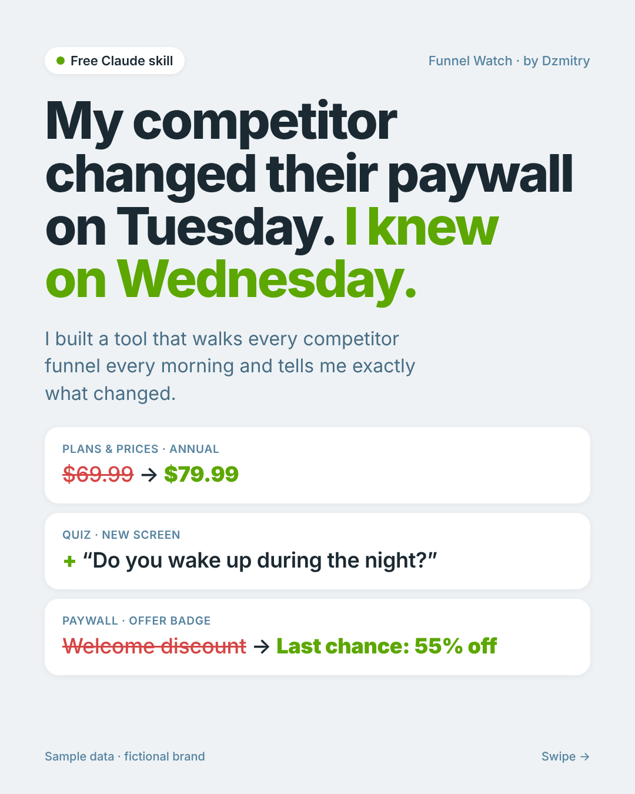
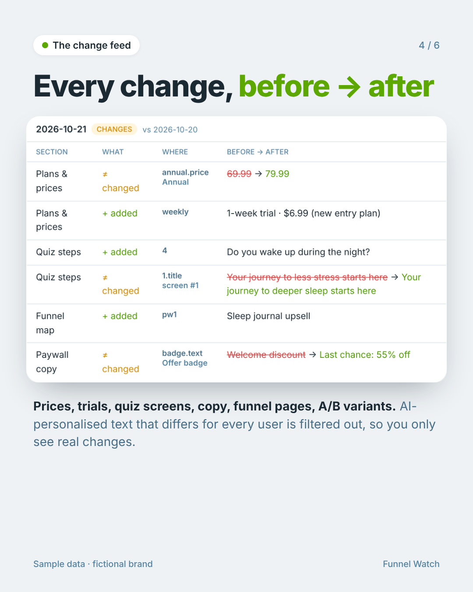

# Funnel Watch

**A mystery shopper for web2app funnels.** Every morning Claude walks every funnel of every competitor you track, all the way to the paywall, and tells you exactly what changed: quiz screens and copy, funnel pages, plans, prices, trials, discounts, upsells and A/B variants.

Free. No code, no server. Runs inside Claude.
Created by **Dzmitry** · [CC BY-NC 4.0](LICENSE)

---

## Install in 3 minutes

### What you need
- A Claude account (Free, Pro, Max or Team) with **Code execution and file creation** turned on: **Settings → Capabilities**.
- The **Claude desktop app** (Mac or Windows). The daily check runs in its built-in browser, so the app needs to be open and the computer awake at check time.

### 1. Download the skill
Download **[funnel-watch.zip](https://github.com/Dmtrue94/funnel-watch/raw/main/funnel-watch.zip)**. Don't unzip it.

### 2. Upload it to Claude
In Claude: **Customize → Skills → + → Create skill → Upload a skill**, then choose `funnel-watch.zip`. Make sure the skill is toggled on.

### 3. Set it up
Open a new chat in the Claude desktop app and write:

> Set up Funnel Watch for https://quiz.competitor1.com and https://quiz.competitor2.com

Claude will ask for a test email (optional, a plus-address like `you+funnels@gmail.com` works) and what time you want the daily check. Then it:
- creates your private **Funnel Watch tracker page**,
- creates a **daily scheduled task**,
- can run the first check right away. That first run is the baseline; changes show up from day two.

### 4. Add or remove competitors any time
Use the watchlist on your tracker page. No need to touch the scheduled task.

---

## What you get

| | |
|---|---|
| **Watchlist** | Every funnel of every competitor. One brand often runs several quizzes for different angles (sleep, stress, weight loss): add each entry URL, from their ads or just the quiz domain. |
| **Change feed** | Every change as "before → after", per competitor, per day. |
| **Plans & prices** | The full plan table the paywall serves to your country. |
| **Funnel map & quiz steps** | Every page and screen the bot went through. |
| **Morning report** | A short summary in Claude: what changed and where. |

## Every funnel, any quiz
Funnel Watch checks all the funnels on your watchlist in one run, so one competitor's sleep funnel, stress funnel and weight-loss funnel are each tracked separately.

A generic walker handles option screens, multi-selects, info screens, height/weight/age inputs, name and email gates, cookie banners and marketing pop-ups. On funnel builders it recognises, it also reads the funnel's own config: timeout prices, exit discounts, downsells, upsells and every quiz branch, not only the one it walked.

## Good to know
- **Prices follow your IP.** Turn on a VPN for the country you care about during the check.
- **Email gates.** Many funnels show prices only after the email screen. Without a test email the walk stops there.
- **Consent boxes.** Some quizzes won't continue without a consent checkbox. The bot ticks them only if you enable it on the tracker.
- **Safety.** It never types passwords and never clicks pay, subscribe, start-trial or claim buttons. It declines marketing opt-ins. Captchas and bot walls are reported, not bypassed.
- **Your data stays yours.** Your tracker is a private page in your own Claude account.

## Troubleshooting
| Status in the feed | What it means |
|---|---|
| `email_gate` | No test email set. Add one on the tracker. |
| `stuck` | The quiz has a screen the walker couldn't pass. Ask Claude: "Check why Funnel Watch got stuck on <competitor>". |
| `failed` | Page didn't load or showed a captcha. |
| No report in the morning | The desktop app was closed or the computer was asleep. |

---

## Author & license
**Funnel Watch is created by Dzmitry** ([github.com/Dmtrue94](https://github.com/Dmtrue94)). Built with Claude.

Licensed under **[CC BY-NC 4.0](LICENSE)**: free to use, share and adapt, as long as you credit *"Funnel Watch by Dzmitry"* with a link to this repo and don't use it commercially without permission. Please don't republish it, or a modified version, as your own.

If you write about it, share it, or build on it: a link back to this repo is all I ask.
